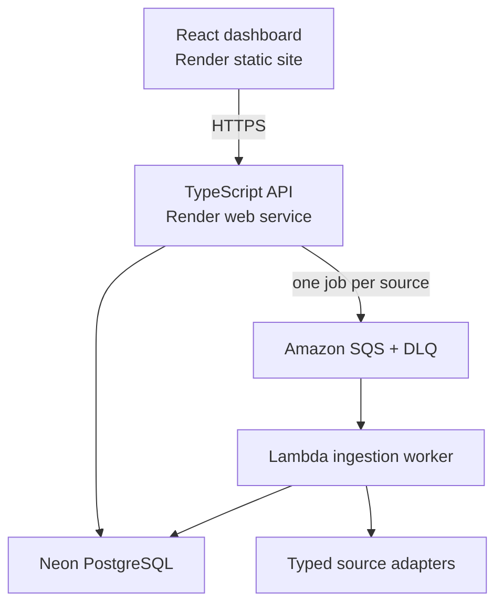

# RTA Vehicle Intelligence

RTA is a portfolio-grade vehicle intelligence platform that acquires inventory from four Ontario automotive sources, validates and normalizes inconsistent records, resolves vehicle identity, and exposes a searchable catalog with operational evidence.

The public demo is fixture-first: recruiters can run the complete asynchronous pipeline without sending automated traffic to third-party sites. Live acquisition is an operator-only capability protected by server-side authorization and independent kill switches.

## What this project demonstrates

- Durable asynchronous work with Amazon SQS and a dead-letter queue
- Idempotent PostgreSQL ingestion using unique `(source_id, external_id)` constraints
- VIN identity plus conservative fallback fingerprints
- Zod validation at request and raw-record boundaries
- Per-source progress, partial failure, retry, and safe error reporting
- Persistent catalog search, saved vehicles, comparison, and source-health views
- Session authentication, operator RBAC, CSRF defense, rate limits, Helmet, strict CORS, and structured logs
- Deterministic fixtures, unit tests, TypeScript strict mode, linting, migrations, and CI

## Architecture



The API returns `202 Accepted` immediately. Browser work is never tied to an HTTP request, and duplicate SQS delivery is safe.

## Applications

| Path | Purpose |
|---|---|
| `rta-scrapper/` | React/TypeScript dashboard (the historical name is retained for branch compatibility) |
| `backend/src/server.ts` | Express API |
| `backend/src/worker/lambda.ts` | Lambda SQS handler |
| `backend/src/worker/local.ts` | Long-polling local worker |
| `backend/src/db/schema.ts` | Drizzle PostgreSQL schema |
| `backend/drizzle/` | Reviewed SQL migrations |

The unrelated dealership CRM in `frontend/` is legacy code and is not part of the portfolio product. It should remain excluded when the hardened branch is made public.

## Quick start

Requirements: Node.js 22+, a PostgreSQL database (Neon is supported), an SQS queue with a DLQ, and AWS CLI credentials for local queue access.

```bash
cp backend/.env.example backend/.env
cp backend/.env.worker.example backend/.env.worker.local
cp rta-scrapper/.env.example rta-scrapper/.env

cd backend
npm ci
npm run db:migrate
npm run db:seed
npm run dev
```

In separate terminals:

```bash
cd backend && npm run worker:dev
cd rta-scrapper && npm ci && npm run dev
```

Open `http://localhost:5173`, click **Run acquisition**, and the API will enqueue four fixture jobs. The worker ingests them into PostgreSQL while the Operations view reports genuine progress.

## Verification

```bash
cd backend && npm run typecheck && npm run lint && npm test && npm run build
cd rta-scrapper && npm run lint && npm run build
```

The renovated UI bundle is approximately 213 kB before gzip, down from the audited 660 kB baseline. This is measured build output, not an invented performance claim.

## Deployment and configuration

- [Environment contract](docs/ENVIRONMENT_SETUP.md)
- [Free-tier deployment guide](docs/DEPLOYMENT.md)
- [Original audit and upgrade plan](docs/RTA_PORTFOLIO_UPGRADE_PLAN.md)

Never commit `.env` files, AWS keys, database URLs, session secrets, cookies, or service-account files. Lambda should use an IAM execution role; the Render API needs a narrowly scoped IAM user until workload identity federation is configured.
