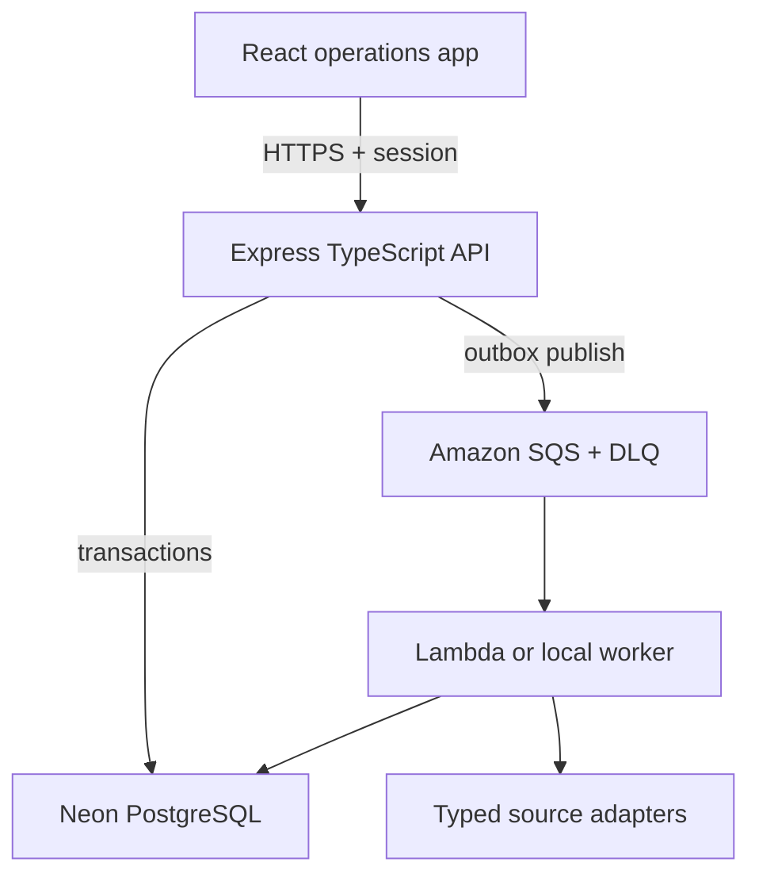

# RTA Automotive Operations & Vehicle Intelligence

RTA is a portfolio-grade, multi-role dealership workspace connected to a durable vehicle-intelligence pipeline. It preserves the original business story—lead follow-up, funded sales, commission visibility, employee targets, team administration, and automotive inventory—while replacing Firebase-era global state and request-bound scraping with PostgreSQL, explicit authorization, Amazon SQS, and independently scalable workers.

## Product capabilities

| Workspace | Implemented behavior |
|---|---|
| Command centre | Live monthly KPIs, target progress, recent opportunities and funded sales |
| Lead pipeline | Search, status filters, assignment, creation and concurrency-safe editing |
| Sales ledger | Create and edit deals, recompute commission, funding states and safe CSV export |
| Team & configuration | Users, roles, account activation, password resets, lead sources and finance providers |
| Compensation | Workspace/user monthly targets and effective-dated commission rules |
| Governance | Secure profile/password changes, private S3 compliance documents and workspace-scoped audit history |
| Analytics | Role-aware performance summaries and a 30-second auto-refreshing presentation board |
| Vehicle intelligence | Search/sort/filter, canonical vehicle details, source offers, private saved vehicles and four-way comparison |
| Acquisition | Fixture or controlled live mode, per-source selection, SQS jobs, cancellation, telemetry and failed-source replay |

## Engineering evidence

- TypeScript strict mode across the API and primary frontend
- PostgreSQL migrations, foreign keys, workspace scoping, targeted indexes, integer money values and basis-point rates
- Idempotency records for write retries and unique source/external listing constraints
- Optimistic concurrency versions on leads and sales to prevent silent overwrites
- Transactional outbox publication to Amazon SQS with a dead-letter queue
- At-least-once-safe ingestion, VIN/fingerprint identity resolution and price observations
- Zod validation at environment, request, queue and source-record boundaries
- Session cookies, CSRF protection, RBAC, rate limiting, Helmet, strict CORS and safe errors
- Structured request/job telemetry, health probes, source-level progress and audit events
- Deterministic demo fixtures, PostgreSQL/API integration tests, frontend behavior tests and GitHub Actions CI
- AWS SAM worker templates with validated Lambda bundles, explicit DLQ wiring, and a safe fixture-first live-browser boundary

## Runtime architecture



The API commits a scrape run, its source runs, and outbox messages together. A dispatcher publishes the messages and returns control independently of browser work. SQS can deliver a message more than once, so worker claims plus database uniqueness make ingestion idempotent.

## Repository map

| Path | Purpose |
|---|---|
| `frontend/` | Primary React/TypeScript dealership and intelligence application |
| `backend/src/modules/dealership/` | Leads, sales, targets, commissions, team and audit APIs |
| `backend/src/modules/catalog/` | Normalized inventory search and vehicle provenance |
| `backend/src/modules/runs/` | Acquisition lifecycle, cancellation and replay |
| `backend/src/worker/` | Shared local and Lambda SQS consumers |
| `backend/src/queue/` | SQS client, contracts and transactional outbox dispatcher |
| `backend/src/db/` | Drizzle schema, migration runner and idempotent demo seed |
| `backend/drizzle/` | Reviewed SQL migrations |
| `infrastructure/aws/` | AWS SAM Lambda and SQS event-source infrastructure |
| `docs/` | Architecture, environment, operations and deployment guides |

## Local development

Requirements: Node.js 22+, PostgreSQL (Neon supported), an SQS queue/DLQ, and AWS credentials with least-privilege access to that queue.

```bash
cp backend/.env.example backend/.env
cp backend/.env.worker.example backend/.env.worker.local
cp frontend/.env.example frontend/.env

cd backend
npm ci
npm run db:migrate
npm run db:seed
npm run dev
```

Run the worker and frontend in separate terminals:

```bash
cd backend && npm run worker:dev
cd frontend && npm ci && npm run dev
```

If Node times out while an IPv4 database connection succeeds on Linux, run migration and seed with:

```bash
NODE_OPTIONS="--no-network-family-autoselection --dns-result-order=ipv4first" npm run db:migrate
NODE_OPTIONS="--no-network-family-autoselection --dns-result-order=ipv4first" npm run db:seed
```

The local SQS worker long-polls silently while idle; an empty terminal after its startup command is normal.

## Demo users

When `SEED_DEMO_DATA=true`, `SEED_DEMO_PASSWORD` is used for:

- `admin@rta.demo`
- `sales@rta.demo`
- `assistant@rta.demo`
- `recruiter@rta.demo`

Use demo-only credentials locally. Never publish a production password in documentation or source control.

## Verification

```bash
cd backend
npm run typecheck
npm run lint
npm test
npm run build

cd ../frontend
npm run lint
npm run typecheck
npm test
npm run build
npm run test:e2e
```

CI creates the backend test environment from `backend/.env.test.example`, runs the PostgreSQL integration suite against its service database, and installs a pinned Firefox runtime for the production-preview smoke tests.

Validate the worker packaging locally after `npm ci` in `backend`:

```bash
cd infrastructure/aws
PATH="$(pwd)/../../backend/node_modules/.bin:$PATH" sam validate --template-file template.yaml --lint
PATH="$(pwd)/../../backend/node_modules/.bin:$PATH" sam build --template-file template.yaml
```

## Operating modes

Fixture mode runs the complete queue, validation, normalization, persistence and UI lifecycle with deterministic source records. It is safe for public demos. Live mode invokes third-party websites and is deliberately protected by `ALLOW_LIVE_SCRAPING`, per-source database switches, operator/admin authorization, conservative concurrency and delays. Local and Lambda workers execute the same processing code.

See [environment setup](docs/ENVIRONMENT_SETUP.md), [API reference](docs/API_REFERENCE.md), [deployment](docs/DEPLOYMENT.md), and [architecture](docs/ARCHITECTURE.md). Never commit environment files, AWS keys, database URLs, session secrets, cookies or service-account files.
