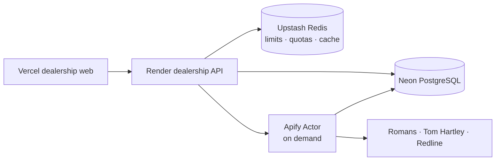

# Architecture decisions

## Current production path

The recruiter-facing path is intentionally compact:

The API owns authentication, authorization, dealership workflows, safe read
projections, Apify dispatch, reconciliation, and operational telemetry. The
Actor is ephemeral and receives no Redis, BullMQ, database, or cloud-worker
credentials. Scraping is initiated by an explicit authorized action.

## Evolution boundary

The repository also contains a complete earlier queue-worker architecture for
reference: BullMQ/private Redis, the scraping API and web app, an Azure worker,
and AWS SQS/Lambda ingestion code. Those components are not silently part of
the current Apify runtime. Their status and safety gates are documented in
[`legacy-reference.md`](legacy-reference.md).

This document records design choices implemented in the portfolio branch. It avoids claims that cannot be demonstrated from code or test output.

## System boundary

Dealer Flow's current production application is a modular API and web frontend. Neon
PostgreSQL is the durable source of truth. Approved vehicle scraping is
executed by short-lived Apify Actor runs started on demand; no permanent scraper
worker is required. Upstash Redis is an ephemeral API-side layer for
distributed rate limits, atomic AI quotas, and short-lived read caches. The
repository retains older BullMQ/Azure and SQS/Lambda ingestion paths for
reference; they are separate from the active Apify flow and disabled unless
explicitly deployed/configured.

## Reliable job creation (retained reference path)

A scrape request writes three kinds of records in one PostgreSQL transaction:

1. One `scrape_runs` aggregate.
2. One `source_runs` record per selected source.
3. One `job_outbox` record per source job.

When explicitly enabled, the outbox dispatcher claims rows with `FOR UPDATE SKIP LOCKED`, publishes them to SQS, and records successful publication. Failed publications use bounded exponential backoff. An abandoned `processing` lease is reclaimed after two minutes. In the portfolio default, rows remain as an inspectable reference without an AWS network call.

This closes the failure window where PostgreSQL commits but the API process exits before calling SQS. If SQS accepts a job and the outbox acknowledgement fails, the job can be published twice; ingestion is designed to tolerate that.

## Idempotency and identity

- HTTP run creation requires an `Idempotency-Key`; `scrape_runs.idempotency_key` is unique.
- Source jobs have stable `sourceRunId` context and a versioned Zod contract.
- Listings use unique `(source_id, external_id)` identity.
- Observations use unique `(source_run_id, listing_id)` identity.
- VIN is the strongest cross-source vehicle identity when valid.
- VIN-less records use a conservative normalized fingerprint.

These constraints enforce correctness in PostgreSQL instead of relying only on application-level checks.

## Queue semantics (retained reference path)

The retained Amazon SQS reference path provides durable at-least-once delivery
when explicitly enabled. Lambda receives one message per batch and returns
partial batch failure information. The event source mapping caps concurrency at
two. Local workers use long polling and extend message visibility while a
browser job is running.

The DLQ isolates repeatedly failing messages. A dedicated reconciliation Lambda consumes terminal DLQ records, marks the related source run `dead_letter`, and recomputes the parent acquisition run. CloudWatch alarms remain responsible for notifying operators.

## Security model

- Server-managed opaque sessions are stored as SHA-256 hashes.
- Session cookies are HTTP-only and configurable for secure cross-site production use.
- Mutations requiring operator authority also require a CSRF token.
- Live scraping has independent API and worker kill switches.
- Zod validates requests, queue messages, and raw listing records.
- Helmet, strict CORS, request limits, rate limiting, safe errors, request IDs, and structured redacted logging are enabled.
- The retained AWS Lambda/SQS implementation uses an IAM execution role and
  narrowly scoped producer permissions when explicitly enabled. The default
  portfolio runtime does not call AWS SQS. The scraping API uses its private
  Compose Redis connection and does not expose Redis publicly.

## Redis and caching

The dealership API connects to Upstash via `REDIS_URL`. Redis is not a durable
database or task queue: it backs distributed rate-limit counters, UTC-day AI
quota counters, and short-lived cache-aside entries for dashboard summaries,
source status, and scraped inventory. PostgreSQL remains authoritative; cache
failures fall back to PostgreSQL. The legacy scraping stack's queue Redis is a
separate retained reference component and is not used by Apify.

## Frontend organization

- `lib/` contains transport and formatting utilities.
- `types/` contains API-facing contracts.
- `components/` contains reusable presentation and vehicle components.
- `App.tsx` owns page-level orchestration and server-state composition.
- TanStack Query owns remote state; local React state is limited to navigation, filters, comparison, and authentication UI.

Loading, empty, API-error, mutation-pending, responsive, and authenticated/live-mode states are represented explicitly.

## Known boundary

The four browser extractors originated as JavaScript and remain isolated behind the typed `acquireListings` adapter. Colocated declaration contracts type their URL-builder and scraper exports, representative source-shaped fixtures exercise each parser boundary, and every result is converted to a typed raw contract and validated before ingestion. A full DOM-parser rewrite remains adapter-specific work that should only be undertaken with fresh saved HTML from verified source pages.
